# Copper Creek – Python Network Automation

## 1. Overview

For this project, I created a fictional company called Copper Creek and worked on automating network administration tasks using Python.

The main goal was to create scripts that could help the IT team identify DNS problems, monitor network devices, send automated alerts, create helpdesk tickets, and fix network issues.

I used GNS3 to test my scripts in a simulated network environment. Throughout the project, I created different Python scripts to automate tasks that would normally require an administrator to manually connect to devices and troubleshoot problems.

## 2. Business Scenario

Copper Creek was experiencing network issues involving several workstations and servers that were using unauthorized DNS servers.

This was a security concern because an unauthorized DNS server could potentially redirect network traffic or cause connectivity problems.

The IT team needed a way to identify affected devices, notify administrators, document incidents, and restore the correct DNS settings.

Instead of manually checking every device, I wanted to use Python to automate as much of the process as possible.

I also wanted to practice using Python to interact with Linux systems, send emails, and communicate with a helpdesk ticketing system.

## 3. Objectives

The goals for this project were to:

- Read network device information from a CSV file.
- Connect to devices and check their DNS configurations.
- Identify devices using unauthorized DNS servers.
- Send automated email alerts to the IT team.
- Create helpdesk tickets using a REST API.
- Check whether internal DNS services were running.
- Restore DNS services when they were down.
- Update affected devices with the correct DNS settings.
- Verify that the DNS configurations were corrected.
- Send an automated resolution email.
- Gain more experience using Python for network automation.

## 4. Technologies Used

- **Python** – Created scripts to automate network administration tasks.
- **GNS3** – Used a simulated network environment for testing.
- **Ubuntu Linux** – Ran commands to check and modify DNS settings.
- **VyOS** – Worked with network devices in the lab.
- **Visual Studio Code** – Developed and tested Python scripts.
- **CSV Files** – Stored network device information.
- **Telnet** – Connected to simulated network devices.
- **SMTP / MailHog** – Sent and verified email notifications.
- **REST API** – Created helpdesk tickets through Python.
- **Requests Library** – Sent HTTP requests to the helpdesk API.
- **resolvectl** – Checked and updated DNS configurations.
- **systemctl** – Checked and managed DNS services.

## 5. Implementation

### Step 1 – Reading Network Devices

**Python Script:** [B1_Read_Devices.py](scripts/B1_Read_Devices.py)

I started by creating a Python script that reads information from a CSV file containing Copper Creek's network devices.

The CSV file included information such as device names, IP addresses, operating systems, and connection details.

I used Python's CSV library to open the file and print the device names in the terminal.

This helped me verify that the script could successfully read the network inventory before moving on to the other tasks.

**Screenshot – Network Devices**

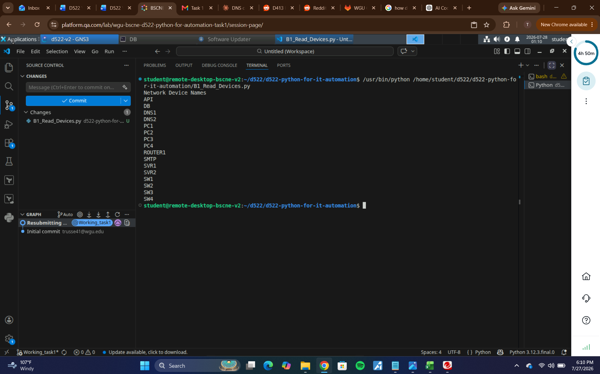

### Step 2 – Checking DNS Configurations

**Python Script:** [B2_DNS_Check.py](scripts/B2_DNS_Check.py)

Next, I created a script that connects to devices using Telnet and checks their DNS settings.

For Ubuntu devices, the script runs `resolvectl status` to determine which DNS servers are configured.

I compared the results against the approved DNS servers for Copper Creek.

**Approved DNS Servers:**

- 10.10.10.10
- 10.10.10.20

**Unauthorized DNS Server Used in Testing:**

- 203.0.113.10

During testing, I identified four devices with suspicious DNS configurations:

- PC2
- PC3
- SVR1
- SVR2

The script displayed the results in the terminal so I could determine which devices needed to be fixed.

**Screenshot – DNS Check Results**

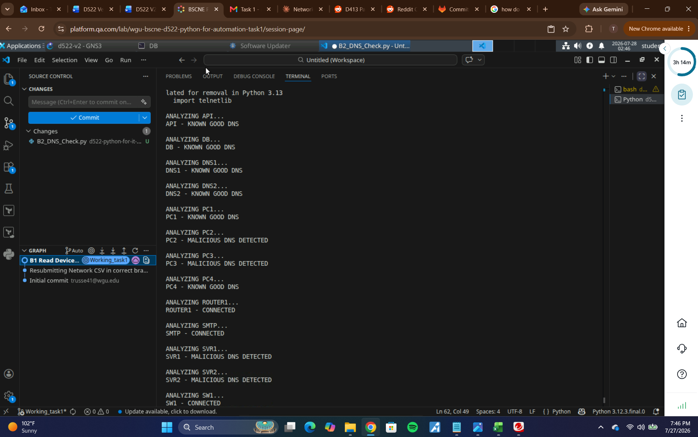

**Screenshot – Additional DNS Check Results**

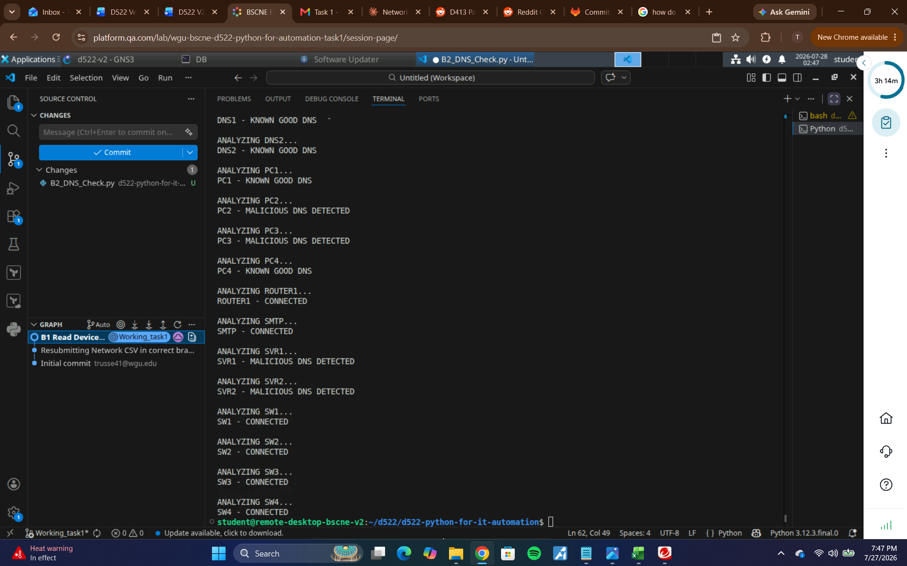

### Step 3 – Sending Automated Email Alerts

**Python Script:** [C1_email.py](scripts/C1_email.py)

After identifying the affected devices, I created a Python script to send an automated email notification.

I used Python's `smtplib` library to connect to the SMTP service in the lab environment.

The email included information about the affected devices, including their names and IP addresses.

The goal was to notify the IT team about the DNS issues without having to manually write an email for every incident.

I tested the script and verified that the message appeared in MailHog.

**Screenshot – Email Script Execution**

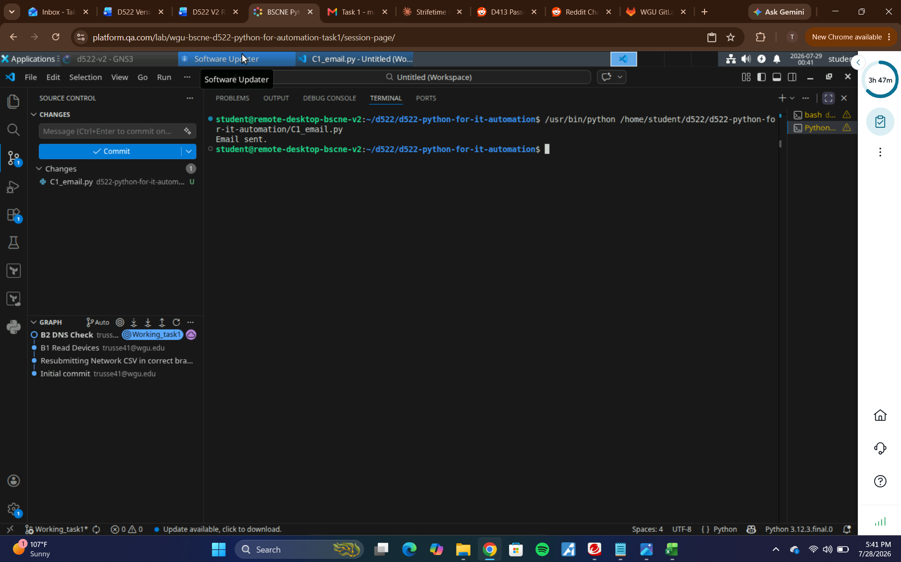

**Screenshot – Email Received**

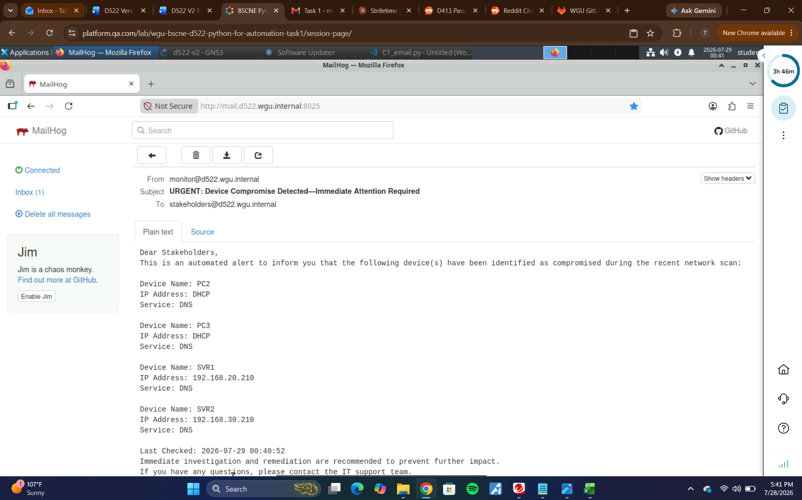

**Screenshot – Email Details**

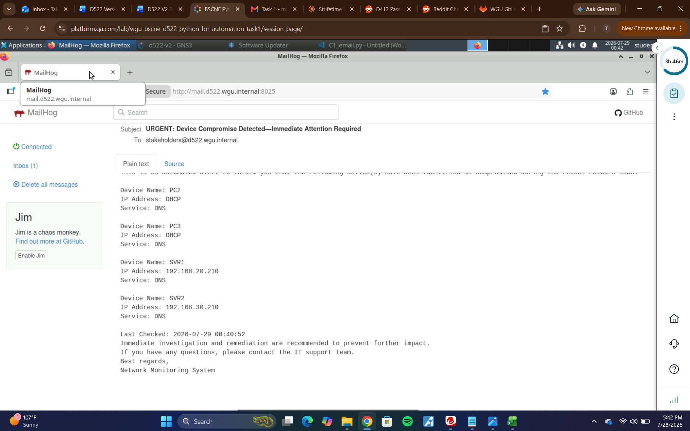

### Step 4 – Creating Helpdesk Tickets

**Python Script:** [C2_Ticket.py](scripts/C2_Ticket.py)

Next, I created a script that submits helpdesk tickets for the affected network devices.

I used Python's `requests` library to communicate with the helpdesk REST API.

The script created a separate ticket for each affected device.

Each ticket included information such as:

- Device name
- Description of the DNS issue
- Ticket priority
- Assigned team
- Ticket status

The four devices were PC2, PC3, SVR1, and SVR2.

I ran the script and checked the API responses to verify that the tickets were created.

The API returned HTTP 201 responses, indicating that the tickets were successfully created.

**Screenshot – Helpdesk Ticket Script**

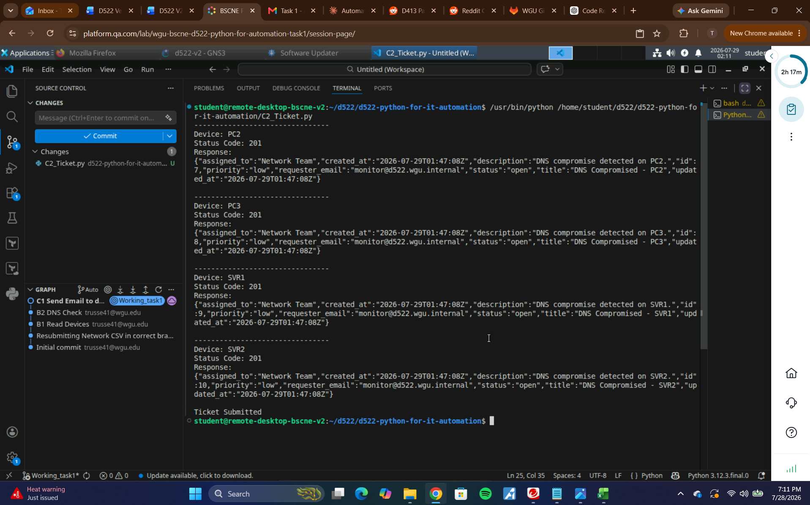

**Screenshot – Created Tickets**

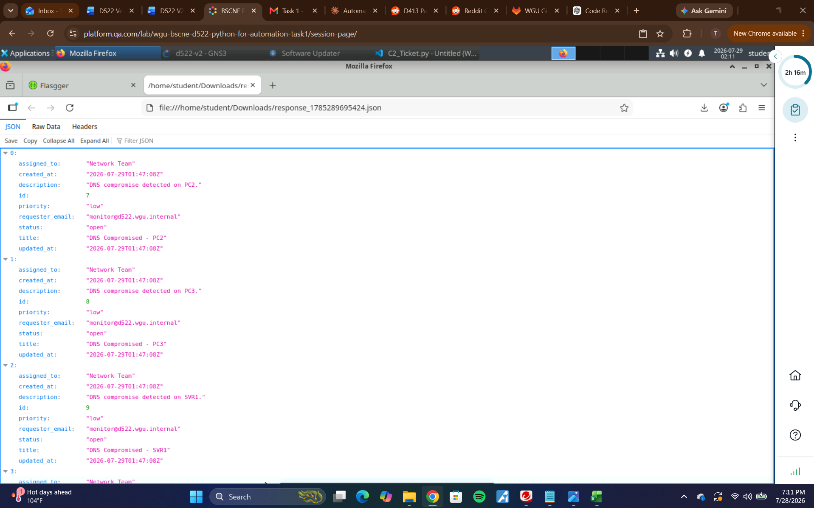

**Screenshot – Additional Ticket Records**

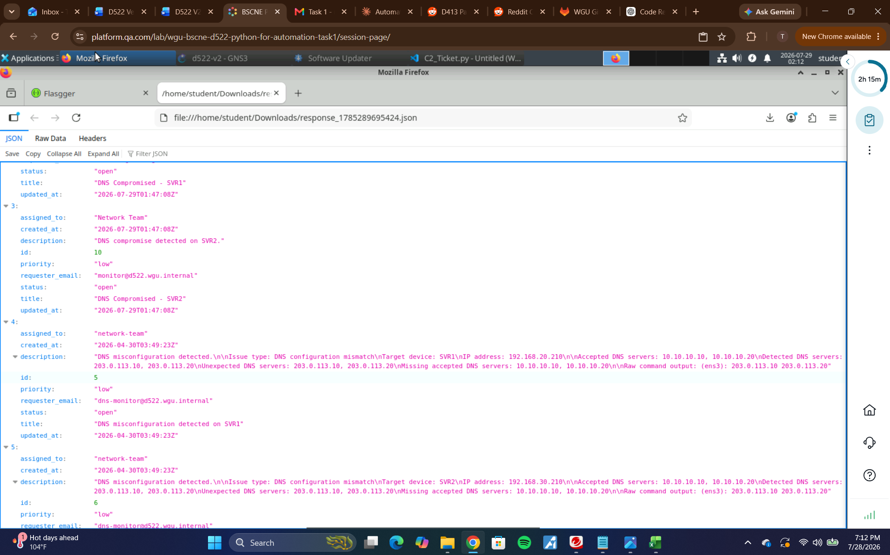

### Step 5 – Verifying DNS Services

**Python Script:** [D1_Verify.py](scripts/D1_Verify.py)

After identifying the affected devices and creating tickets, I checked the status of Copper Creek's internal DNS servers.

The environment contained two DNS servers:

- DNS1
- DNS2

I created a Python script that connects to the servers and checks whether the DNS service is running.

The script runs the following Linux command:

`systemctl is-active named`

This command checks whether the `named` DNS service is active.

During my initial testing, I found that DNS1 was active while DNS2 was inactive.

This helped me determine which service needed to be restored.

**Screenshot – DNS Service Verification**

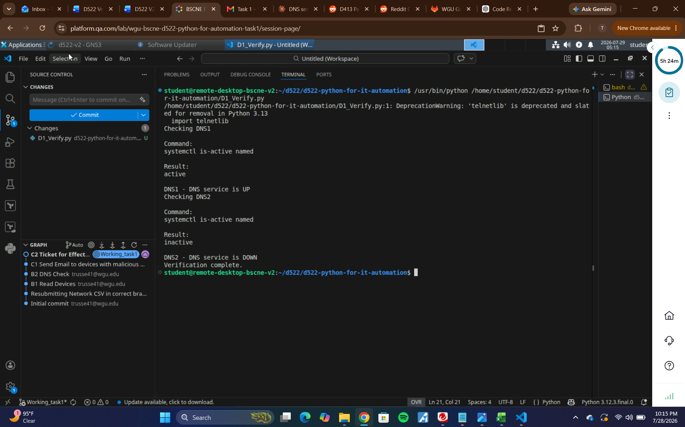

### Step 6 – Restoring DNS Services

**Python Script:** [D2_Restart.py](scripts/D2_Restart.py)

After checking the DNS services, I created another script to bring the services back online.

The script connects to both DNS servers and runs:

`sudo systemctl start named`

After running the command, the script checks the service status again to verify that it is active.

I tested the script and confirmed that both DNS servers were reporting an active service afterward.

This gave me more experience using Python to automate Linux service management.

**Screenshot – DNS Service Restoration**

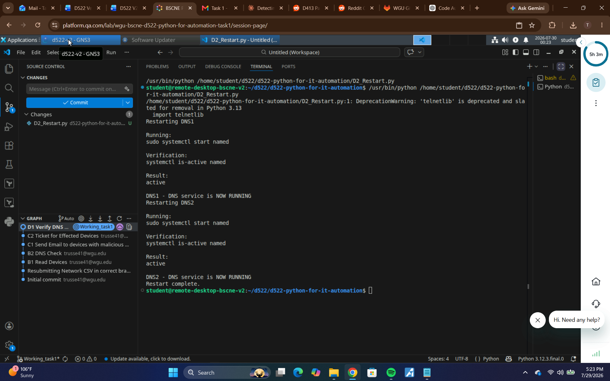

**Screenshot – DNS Services Running**

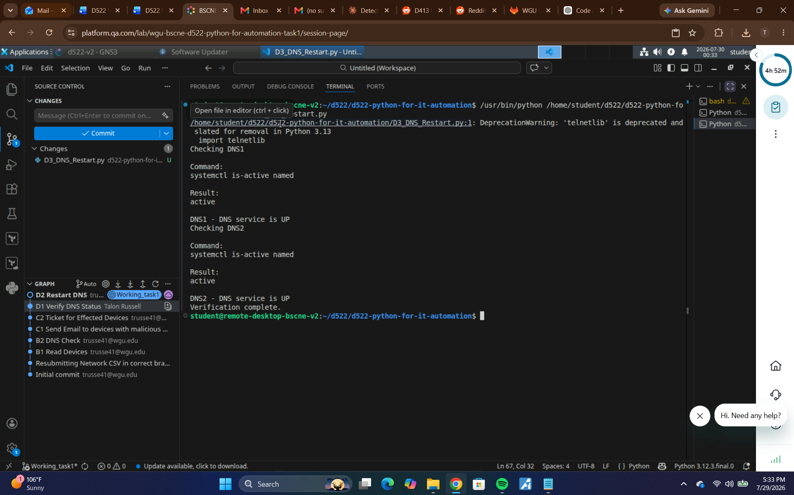

### Step 7 – Correcting DNS Configurations

**Python Script:** [D4_Resolve.py](scripts/D4_Resolve.py)

Once the DNS services were working, I created a script to correct the DNS configurations on the affected devices.

The four affected devices were:

- PC2
- PC3
- SVR1
- SVR2

The script connects to each device and updates its DNS settings to use Copper Creek's approved DNS servers.

I used the following Linux command:

`sudo resolvectl dns ens3 10.10.10.10 10.10.10.20`

After updating the settings, the script runs `resolvectl status` to verify that the correct DNS servers appear.

The script reported successful updates for all four affected devices.

I also checked the DNS configurations on the individual devices to confirm the results.

**Screenshot – DNS Remediation Script**

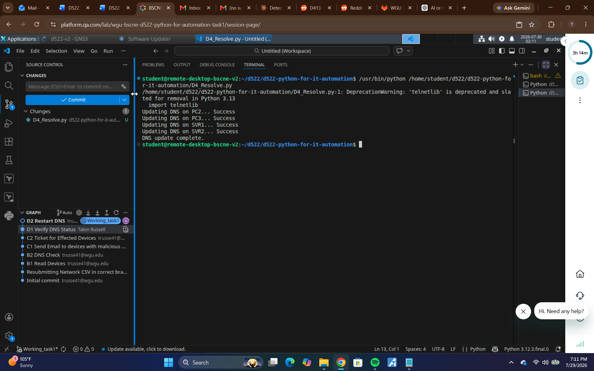

**Screenshot – PC2 DNS Configuration**

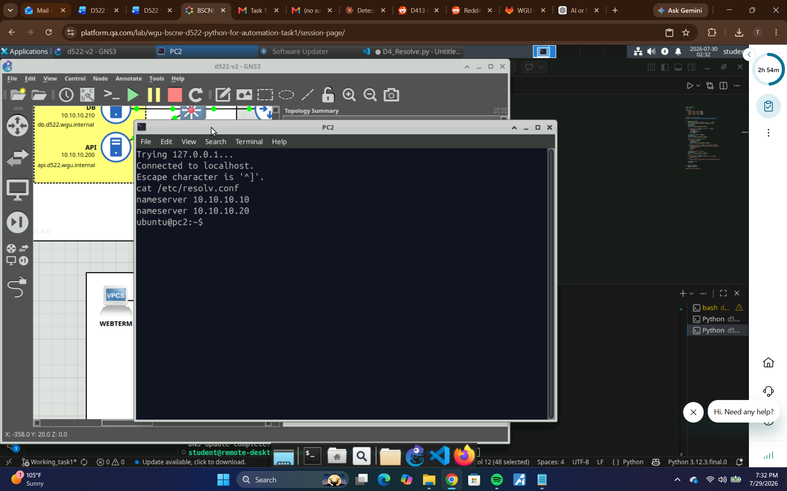

**Screenshot – PC3 DNS Configuration**

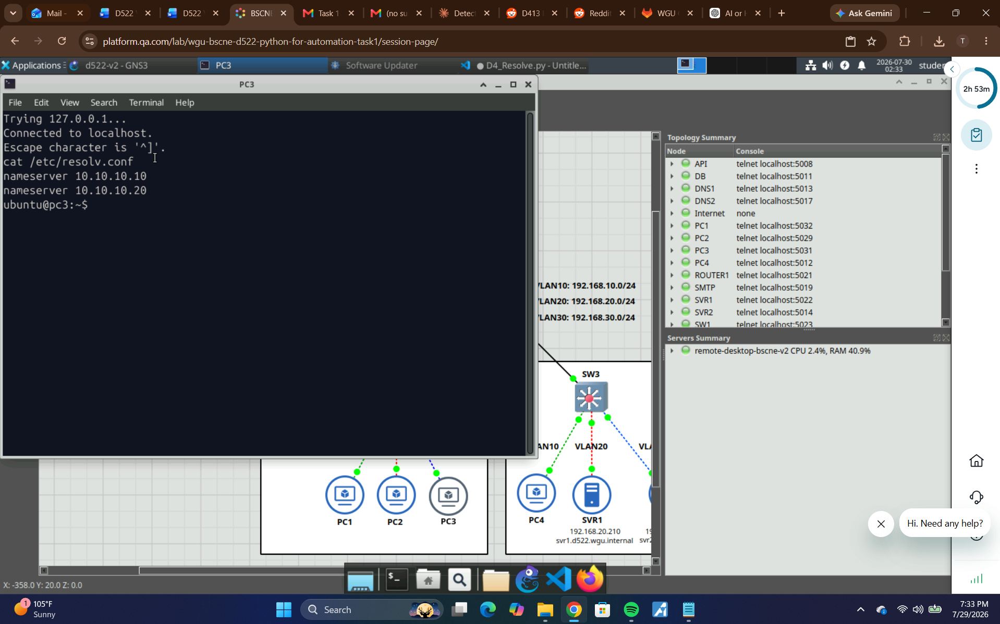

**Screenshot – SVR1 DNS Configuration**

**Screenshot – SVR2 DNS Configuration**

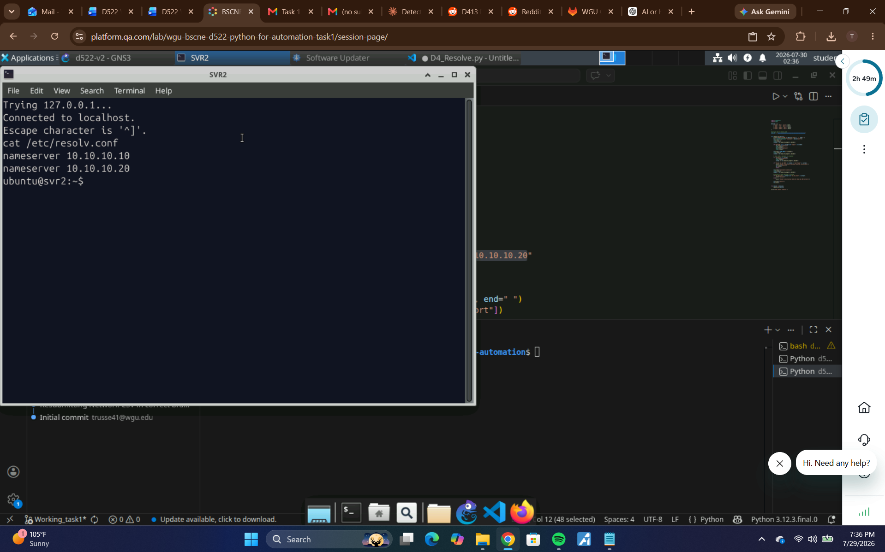

### Step 8 – Sending a Resolution Email

**Python Script:** [E1 Resolution Email.py](scripts/E1%20Resolution%20Email.py)

For the final step, I created another Python script that sends an automated resolution email.

The goal was to notify the IT team that the DNS issues had been addressed.

The email included the names and IP addresses of the affected devices.

I tested the script using the lab's SMTP service and verified that the resolution email appeared in MailHog.

This completed the incident notification and remediation process.

**Screenshot – Resolution Email Script**

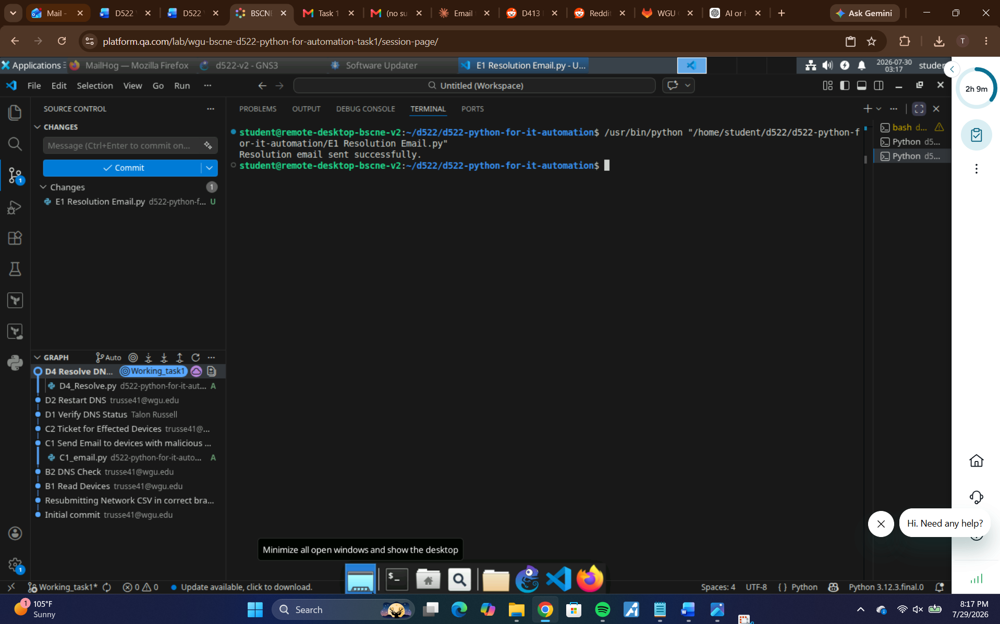

**Screenshot – Resolution Email Received**

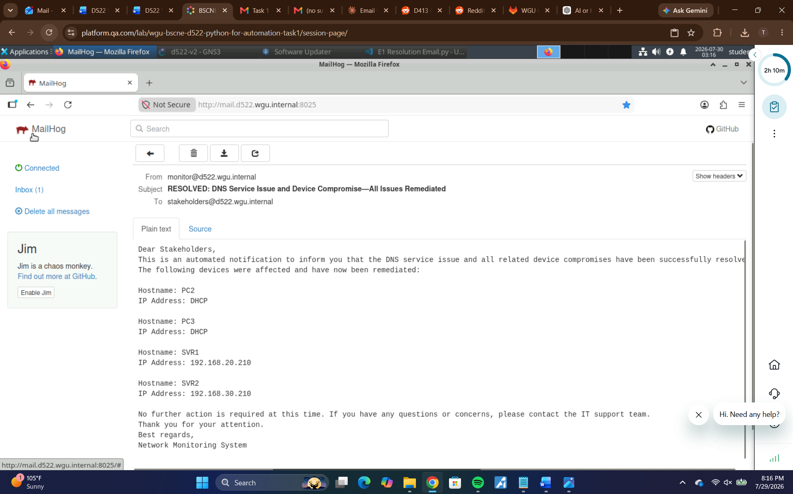

## 6. Validation

After completing the scripts, I went back through the lab and reviewed the results.

I checked the terminal output, helpdesk ticket responses, DNS configurations, and email notifications to confirm that the individual tasks were working.

### Test Results

| Test | Result |
|---|---|
| Read network devices from CSV | Pass |
| Connect to network devices | Pass |
| Identify unauthorized DNS settings | Pass |
| Identify four affected devices | Pass |
| Send automated incident email | Pass |
| Create helpdesk tickets | Pass |
| Verify DNS service status | Pass |
| Restore DNS services | Pass |
| Update PC2 DNS configuration | Pass |
| Update PC3 DNS configuration | Pass |
| Update SVR1 DNS configuration | Pass |
| Update SVR2 DNS configuration | Pass |
| Send resolution email | Pass |

All of the individual tasks produced the expected results in the simulated environment.

I was able to identify devices with incorrect DNS settings, send notifications, create helpdesk tickets, restore DNS services, and verify corrected DNS configurations.

The scripts were developed and tested separately rather than as one fully integrated application.

## 7. Security Considerations

While completing this project, I also considered how network automation could affect security in a real organization.

### DNS Security

One of the main concerns was identifying devices using unauthorized DNS servers.

If a device uses an untrusted DNS server, its DNS requests could potentially be redirected to an unauthorized system.

Checking DNS configurations against an approved list can help administrators identify suspicious settings.

### Secure Remote Access

I used Telnet to connect to devices because it was available in the lab environment.

In a real organization, I would use SSH instead because Telnet does not encrypt the connection.

### Credentials and API Keys

Some of my scripts use hard-coded login credentials and API tokens because they were created for a simulated environment.

In a production environment, I would store credentials more securely using environment variables or a secrets management solution instead of putting them directly in the scripts.

### Automated Changes

Automating network changes can save time, but it is important to make sure scripts do not accidentally modify the wrong devices.

For this project, I used a specific list of affected devices and verified their DNS settings after making changes.

### Verification

One important part of the project was verifying that the scripts actually made the intended changes.

A script running without errors does not always mean the underlying issue has been fixed.

Checking the DNS settings and service status afterward helped confirm the results.

## 8. Lessons Learned

This project helped me become more comfortable using Python for network administration and troubleshooting.

One of the main things I learned was how Python can reduce the amount of repetitive work involved in managing network devices.

Instead of manually connecting to every device, I was able to create scripts that performed several of the tasks automatically.

I also gained experience working with CSV files, Telnet connections, Linux commands, REST APIs, and automated email notifications.

### Challenges I Encountered

**Connecting to Different Devices**

One challenge was figuring out how to connect to different types of devices in the simulated network.

Not every device used the same operating system, so I had to account for differences when checking their configurations.

This helped me understand the importance of knowing the environment before trying to automate tasks.

**Working with REST APIs**

Another challenge was learning how to send information to the helpdesk system through an API.

I had to understand how to format the ticket information and submit HTTP requests using Python.

After testing the script, I was able to verify that the tickets were created successfully.

**Verifying DNS Changes**

I also had to make sure the DNS settings were actually being updated.

Instead of only relying on the script's success message, I checked the DNS configurations on the affected devices.

This helped me understand why validation is an important part of network automation.

### Final Thoughts

Overall, this project gave me more hands-on experience with Python, Linux, networking, and automation.

I was able to create several scripts that performed different network administration tasks, including monitoring DNS configurations, sending alerts, creating tickets, restoring services, and correcting device settings.

For future improvements, I would like to combine the scripts into one program, add better error handling, use SSH instead of Telnet, and automatically generate tickets based on scan results.

## References

- [Python Documentation](https://docs.python.org/3/)
- [Python smtplib Documentation](https://docs.python.org/3/library/smtplib.html)
- [Requests Documentation](https://requests.readthedocs.io/)
- [GNS3 Documentation](https://docs.gns3.com/)
- [Ubuntu Documentation](https://documentation.ubuntu.com/)
